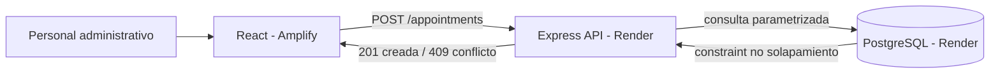
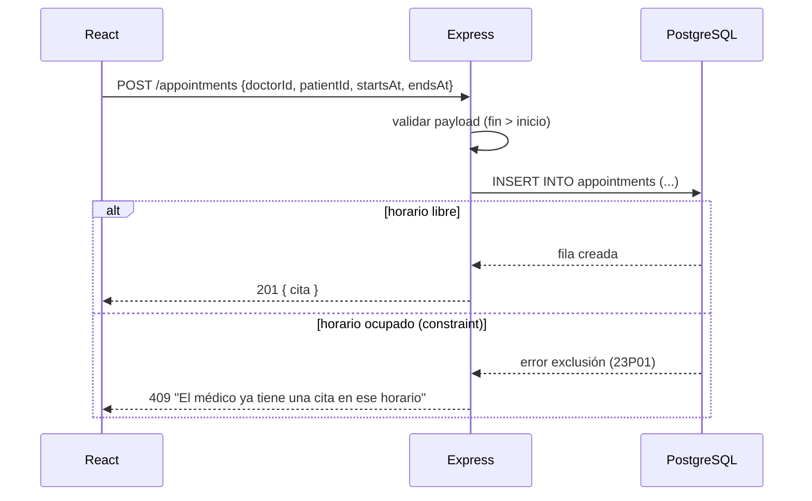

# Diseño — MVP: Agendar una cita

## Resumen

Flujo de agendamiento de una cita con rechazo de solapamiento. La regla "un
médico no puede tener dos citas en el mismo horario" se hace cumplir en dos
niveles: validación en el backend (respuesta amable) y una constraint en
PostgreSQL (garantía ante concurrencia). La constraint es la fuente de verdad;
la validación previa solo mejora el mensaje al usuario.

## Arquitectura



Diagrama de capas solicitado (React → Express → PostgreSQL):

```
┌──────────────┐     HTTPS/JSON      ┌──────────────┐     SQL (pg)      ┌──────────────┐
│    React     │ ──────────────────▶ │   Express    │ ────────────────▶ │  PostgreSQL  │
│  (Amplify)   │ ◀────────────────── │   (Render)   │ ◀──────────────── │   (Render)   │
│  formulario  │   201 / 400 / 409   │   API REST   │   fila / error     │  appointments│
└──────────────┘                     └──────────────┘                    └──────────────┘
```

Nota: este diagrama está en texto/Mermaid porque el MCP de draw.io no está
activo en esta sesión. Con el MCP cargado, el arquitecto puede regenerarlo con
`create_diagram` a partir de este mismo Mermaid.

## Flujo de agendamiento (secuencia)



## Componentes

### Backend (Express)

- **Ruta** `POST /appointments` → `createAppointment` handler.
- **Validación** del payload: campos presentes y `endsAt > startsAt` → 400 si no.
- **Capa de datos** (`appointmentsRepository.create`): `INSERT` parametrizado en
  `appointments`. No se hace un `SELECT` previo como única defensa: se confía en
  la constraint y se captura su error.
- **Mapeo de errores**: el código de error de PostgreSQL `23P01`
  (`exclusion_violation`) se traduce a HTTP 409 con mensaje en español. Otros
  errores → 500 genérico (sin filtrar datos de paciente al log).
- **Ruta de apoyo** `GET /doctors/:id/appointments?date=YYYY-MM-DD` para pintar
  la agenda del día.

Conexión con `pg.Pool`, SSL en producción, `DATABASE_URL` por variable de
entorno.

### Base de datos (PostgreSQL)

Se apoya en el esquema de la skill `postgres-agenda`. Lo esencial para esta
feature:

```sql
-- appointments ya define:
--   time_range tstzrange GENERATED ALWAYS AS (tstzrange(starts_at, ends_at)) STORED
--   status in ('confirmed','cancelled','completed'), reminder_sent boolean

ALTER TABLE appointments
  ADD CONSTRAINT appointments_no_overlap
  EXCLUDE USING gist (
    doctor_id WITH =,
    time_range WITH &&
  )
  WHERE (status <> 'cancelled');
```

- `doctor_id WITH =` + `time_range WITH &&` → rechaza solapamientos del mismo
  médico.
- `WHERE (status <> 'cancelled')` → una cita cancelada libera el horario.
- Requiere la extensión `btree_gist`.

### Frontend (React)

- **Componente** `AppointmentForm` (funcional, con hooks): selects de paciente y
  médico, inputs de fecha/hora inicio y fin.
- **Estado** del formulario local; estado de la agenda centralizado en un store
  único de verdad.
- **Manejo del 409**: muestra mensaje accesible (rol `alert`) sin borrar el
  formulario, para corregir el horario.
- **Éxito**: confirma y refresca la agenda del día del médico seleccionado.

## Manejo de errores

| Situación                          | Backend | Mensaje UI                                         |
|------------------------------------|---------|----------------------------------------------------|
| Payload inválido (fin ≤ inicio)    | 400     | "Revisa las horas: el fin debe ser posterior."     |
| Horario ocupado (constraint 23P01) | 409     | "El médico ya tiene una cita en ese horario."      |
| Error inesperado                   | 500     | "No se pudo agendar. Intenta de nuevo."            |

Los logs del backend registran el código de error, nunca datos del paciente.

## Estrategia de pruebas

- **Backend (unit/integration)**:
  - Agendar en horario libre → 201.
  - Agendar solapando con cita `confirmed` → 409.
  - Agendar solapando con cita `cancelled` → 201 (horario liberado).
  - `endsAt <= startsAt` → 400.
  - Inserciones concurrentes solapadas → solo una se guarda (constraint).
- **Frontend**:
  - Render del formulario y envío feliz.
  - Respuesta 409 muestra el mensaje y conserva los datos.
